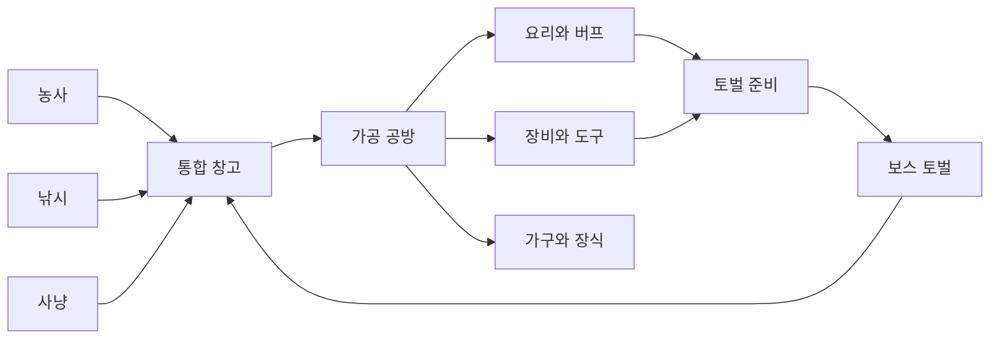

# 사냥·토벌·통합 가공 시스템 기획

> 최신 요구사항(2026-10-14): 토벌의 핵심은 **점수제와 유저 간 점수 공유**다. 이 변경은 기획 문서에만 반영하며 기능은 아직 구현하지 않는다. 기존 전투·보상 항목은 제안이고, 점수 계산·공유 방식의 세부안은 아래 16절을 따른다.

## 1. 설계 목표

농사·낚시·사냥을 서로 독립된 돈벌이 수단으로 두지 않고, 통합 창고와 가공 공방을 중심으로 순환시키는 것이 목표다.

- **농사:** 채소·곡물·과일·약초 생산
- **낚시:** 생선·조개·수초·특수 수산물 획득
- **사냥:** 고기·가죽·뼈·깃털·희귀 소재 획득
- **토벌:** 세 생활 콘텐츠로 준비한 장비와 소모품으로 도전하고, 점수를 기록해 다른 유저와 공유하는 콘텐츠
- **가공:** 여러 활동의 재료를 요리·장비·도구·가구로 변환
- **통합 창고:** 현재와 미래의 모든 획득물이 들어가는 공용 인벤토리

## 2. 사냥과 토벌의 역할 구분

### 사냥

일상적인 재료 수집 콘텐츠다. 비교적 짧고 반복하기 쉬우며, 통합 창고에 넣을 원재료를 얻는다.

1. 사냥터와 목표 동물 선택
2. 미끼와 장비 선택
3. 흔적 추적 미니게임
4. 짧은 조우·포획 미니게임
5. 전리품을 통합 창고로 이동

### 토벌

농사·낚시·사냥으로 준비한 결과물을 소비하는 중간·최종 목표다. 복잡한 액션보다 준비와 패턴 공략을 중심으로 한다.

1. 보스 정보와 약점 확인
2. 무기·방어구·음식·도구·동행 펫 편성
3. 공격 예고를 관찰해 공격·방어·회피·아이템·펫 기술 선택
4. 3~5초짜리 행동 미니게임 수행
5. 부위 파괴와 보스 공략
6. 토벌 점수와 평가 내역 확인, 개인 기록 저장 및 유저 간 공유
7. 보스 소재·트로피·해금 보상 획득(보상 구성은 제안)

## 3. 사냥터 구성

| 사냥터 | 주요 동물 | 핵심 보상 | 난이도와 특징 |
|---|---|---|---|
| 들판 | 토끼·꿩·멧돼지 | 고기·털·깃털 | 입문 지역, 농작물 미끼 활용 |
| 숲 | 사슴·여우·곰 | 가죽·뿔·고기 | 추적 중심 |
| 습지 | 오리·수달·뉴트리아 | 깃털·기름·방수 가죽 | 낚시 재료와 연계 |
| 설산 | 산양·늑대 | 두꺼운 가죽·희귀 뿔 | 겨울 장비 필요 |
| 고대 숲 | 정령수·환상 동물 | 마력 소재 | 토벌 이후 해금되는 고급 지역 |

게임 분위기를 유지하기 위해 과도하게 잔혹한 표현보다 추적·마취 화살·포획·정령 정화 같은 표현을 우선한다.

## 4. 사냥 준비와 생활 콘텐츠 연결

### 농사 재료를 사냥에 사용

- 옥수수·고구마 → 멧돼지 미끼
- 당근·양배추 → 토끼 미끼
- 약초 → 회복약·해독제
- 목화·삼 → 붕대·덫 끈
- 버섯 → 냄새 유인제

### 낚시 재료를 사냥에 사용

- 작은 물고기 → 곰·여우·새 미끼
- 물고기 기름 → 방수 장비·등불
- 조개껍데기 → 소리 미끼·장식 재료

### 사냥 재료를 농사와 낚시에 사용

- 뼛가루 → 고급 비료
- 깃털 → 낚시 찌·루어
- 가죽 → 도구 가방·창고 확장품
- 뿔 → 농기구 손잡이
- 벌레 주머니 → 낚시 미끼

## 5. 사냥 전리품 품질

농산물과 동일하게 `보통 → 좋음 ★ → 최상 ★★ → 전설 ✨` 체계를 사용한다.

품질에 영향을 주는 요소:

- 추적 정확도
- 조우 미니게임 성공률
- 장비 등급
- 계절과 날씨
- 목표와 미끼의 궁합
- 포획 과정에서 받은 손상

전설 동물은 반복적으로 처치하는 대상보다 발견·관찰 기록과 특별 소재를 남기는 희귀 이벤트로 표현한다.

## 6. 통합 가공 시스템

### 주방

농산물·생선·고기를 조합해 판매용 음식과 토벌 버프 음식을 만든다.

| 가공품 | 주요 재료 | 효과 또는 용도 |
|---|---|---|
| 감자 고기조림 | 감자 + 멧돼지고기 | 지속 회복 |
| 연어 덮밥 | 곡물 + 연어 + 채소 | 회피 가능 횟수 증가 |
| 매운 전골 | 배추 + 고기 + 고추 | 공격력 증가 |
| 산천어 맑은탕 | 민물고기 + 버섯 + 약초 | 상태 이상 저항 |
| 생선 파이 | 밀 + 달걀 + 생선 | 추적 제한시간 증가 |
| 산해진미 도시락 | 곡물 + 채소 + 생선 + 고기 | 하루 한 번 강력한 복합 버프 |

### 훈연소·건조대

접속하지 않아도 시간이 흐르는 장기 가공 시설이다.

- 생선 → 훈제 생선
- 고기 → 육포
- 과일 → 말린 과일
- 약초 → 말린 약초
- 생가죽 → 무두질한 가죽

원재료보다 가치가 높지만 작업 슬롯을 오래 차지한다.

### 공구 작업대

- 나무 + 가죽 → 씨앗 가방
- 뼈 + 철 → 고급 낚싯바늘
- 가죽 + 깃털 → 화살통
- 뿔 + 목재 → 고급 괭이
- 방수 가죽 + 실 → 낚시 가방

### 인테리어 공방

- 가죽 러그
- 사슴뿔 벽 장식
- 동물 관찰 사진 액자
- 조개 장식
- 물고기 수족관
- 볏짚 쿠션
- 계절별 토벌 트로피 진열장

## 7. 다양한 활동을 유도하는 규칙

시장 가격만으로 다양성을 강제하지 않고 레시피와 목표를 활용한다.

- 서로 다른 분야의 재료가 많을수록 완성품 품질 보너스
- 오늘의 추천 레시피를 매일 변경
- 계절 한정 재료 사용 시 특별 등급 등장
- 미션에서 원재료와 가공품을 함께 요구
- 정확한 품목 대신 `채소 2종 + 고기 1종` 같은 재료 범주 레시피 제공
- 부족한 재료는 시장 구매 또는 대체 재료로 보완 가능
- 오래 숙성할수록 가치가 오르지만 작업 슬롯을 오래 점유

세 활동을 모두 하면 유리하되, 반드시 모두 해야만 진행할 수 있는 구조는 피한다.

## 8. 토벌 준비 화면

토벌 전에 다음 항목을 편성한다.

- 무기 1개
- 방어구 1개
- 음식 2개
- 함정 또는 도구 1개
- 동행 펫 1마리

준비 예시:

- 매운 생선전골 → 공격력 증가
- 약초 고기찜 → 지속 회복
- 훈제 연어 → 회피 횟수 증가
- 튼튼한 가죽옷 → 받는 피해 감소
- 그물 함정 → 빠른 적의 이동 봉쇄
- 고양이 펫 → 약점 발견 확률 증가

생활 콘텐츠로 잘 준비하면 전투가 쉬워지고, 조작 실력이 있으면 부족한 준비를 일부 보완할 수 있어야 한다.

## 9. 토벌 전투

### 공격 예고와 행동 선택

보스 행동을 시각적으로 예고한다.

- 눈이 빛남 → 돌진
- 땅을 긁음 → 광역 공격
- 몸을 웅크림 → 방어
- 울음소리 → 부하 소환

유저는 제한시간 안에 `공격 / 회피 / 방어 / 아이템 / 펫 기술`을 선택한다.

### 행동 미니게임

- 공격 → 움직이는 약점 타이밍 맞추기
- 회피 → 위험 구역 피하기
- 방어 → 게이지 중앙에서 멈추기
- 포획 → 흔들리는 조준점 맞추기
- 치료 → 표시되는 약초를 순서대로 선택

한 번의 토벌은 약 2~4분을 목표로 한다.

### 부위 파괴

- 뿔 파괴 → 돌진 약화, 뿔 소재 획득
- 꼬리 파괴 → 휩쓸기 범위 감소
- 갑옷 파괴 → 방어력 감소
- 날개 파괴 → 비행 패턴 봉쇄

필요한 소재에 따라 공격할 부위를 선택하게 만들어 단순한 체력 감소 반복을 피한다.

## 10. 토벌 실패 규칙

- 장비는 사라지지 않는다.
- 사용한 음식과 소모품만 소진된다.
- 실패해도 관찰 기록과 소량의 흔적 재료를 받는다.
- 같은 보스에게 실패하면 최대 3회까지 `공략 지식`이 쌓인다.
- 공략 지식은 공격 예고시간 증가 또는 받는 피해 감소를 제공한다.

실패도 다음 성공을 위한 진행으로 남아야 한다.

## 11. 토벌 보스 후보

| 보스 | 계절 | 주요 패턴 | 생활 콘텐츠 대응 |
|---|---|---|---|
| 꽃가루 멧돼지 | 봄 | 돌진·꽃가루 시야 방해 | 약초 해독제·그물 |
| 폭풍 메기왕 | 여름 | 물웅덩이·번개 | 낚시 미끼·절연 가죽 |
| 단풍 뿔사슴 | 가을 | 분신·고속 이동 | 향기 미끼·추적 펫 |
| 설산 철갑곰 | 겨울 | 빙결·강한 방어 | 따뜻한 요리·갑옷 파괴 |
| 창고 탐식왕 | 특별 | 보관 재료를 먹고 변화 | 다양한 재료와 창고 관리 |
| 시장 포화 정령 | 특별 | 최근 많이 판 작물에 내성 | 여러 작물·가공품 활용 |

`시장 포화 정령`은 최근 많이 판매한 작물 속성을 흡수해 해당 재료 기반 공격에 강해진다. 현재 시장 포화 시스템을 토벌 전략과 연결하고 여러 작물을 준비하도록 유도할 수 있다.

## 12. 보상 설계

돈만 지급하면 토벌이 또 하나의 최고 수익 콘텐츠가 되므로, 새로운 선택지를 여는 보상을 중심으로 한다.

- 최초 토벌: 신규 지역·작업대·레시피·기능 해금
- 반복 토벌: 장비 제작 소재·강화 재료
- 수집 보상: 보스 가구·트로피·프로필 테두리
- 생활 보상: 특별 씨앗·낚시 미끼·창고 확장 재료
- 펫 보상: 펫 장비·외형
- 도전 보상: 칭호·색상 변형

## 13. 반복 도전 조건

매번 같은 방식으로 체력만 깎는 플레이를 피하기 위해 선택형 주간 조건을 제공한다.

- 회복 음식 최대 1개
- 지정 무기 사용
- 특정 부위 파괴 후 마무리
- 펫 없이 성공
- 제한시간 안에 성공
- 세 종류 이상의 가공품 사용
- 받은 피해 일정량 이하

조건은 추가 보상을 주되 기본 토벌 보상을 막지 않는다.

## 14. 권장 MVP

### 사냥 MVP

- 사냥터: 들판·숲 2곳
- 동물: 6종
- 장비: 나무 활·사냥 활·정밀 활 3종
- 미끼: 농산물·생선 기반 4종
- 추적 미니게임 1종
- 전리품 10종
- 복합 가공 레시피 8종
- 사냥 전용 `바로 판매 / 창고 보관` 설정
- 사냥 미션을 기존 공용 미션에 통합

### 토벌 MVP: 꽃가루 멧돼지

1. 준비 화면
2. 음식·장비·펫 편성
3. 공격·방어·회피 선택
4. 돌진과 꽃가루 패턴
5. 엄니 부위 파괴
6. 성공·실패와 공략 지식
7. 토벌 점수 산출·개인 최고 점수 저장·다른 유저에게 결과 공유
8. 최초 보상으로 엄니 장식과 고급 비료 레시피 해금(제안)

꽃가루 멧돼지로 기본 재미를 검증한 뒤 폭풍 메기왕을 추가해 농사·낚시·사냥 연결까지 시험한다.

## 15. 핵심 원칙

토벌은 전투 실력만으로 이기는 게임이 아니다. 생활 콘텐츠로 충분히 준비하면 안정적으로 이길 수 있고, 조작 실력이 있으면 부족한 준비를 보완할 수 있는 구조를 지향한다.

## 16. 토벌 점수제와 유저 간 공유 (2026-10-14)

### 확정 요구사항

- 토벌의 핵심 진행·평가는 **점수제**로 만든다.
- 획득한 점수를 **유저들끼리 공유**할 수 있어야 한다.
- 이번 작업은 MD 기획 기록만 진행한다. 전투·점수 계산·공유 API·랭킹 UI는 구현하지 않는다.

### 점수 산정 제안 — 미확정

- 결과 화면에 총점과 항목별 점수를 함께 표시한다.
- 기본 항목 후보: 토벌 성공, 제한시간 대비 공략 속도, 회피·방어 정확도, 부위 파괴, 받은 피해, 추가 도전 조건 달성.
- 성공만 점수를 주기보다 실패에도 공략 진행도에 따른 점수를 남겨 개인 기록을 비교하도록 한다.
- 처치 시간 단축으로 장비가 이미 점수에 영향을 주므로 장비 가격·등급 자체에는 추가 점수를 주지 않는 안을 권장한다.
- 같은 행동을 반복해 점수를 무한히 쌓지 못하도록 항목별 상한을 둔다. 부위 파괴는 부위당 한 번, 시간 보너스는 성공 시에만 주는 안을 검토한다.
- 총점 상한, 항목별 배점, 난이도 배율, 실패 시 최대 점수, 동점 처리 규칙은 아직 정하지 않았다.
- 토벌 점수를 소비하는 교환 재화로 쓸지는 미정이다. 우선 도전 기록용 점수로 두는 안을 권장한다.

### 유저 간 공유 제안 — 미확정

- 최소 구현은 결과 화면의 ‘점수 공유’ 버튼이다. 닉네임, 보스, 난이도, 총점, 성공 여부, 공략 시간, 달성일을 담은 결과 카드나 공유 링크를 제공한다.
- 클립보드 복사나 이미지 저장을 대안으로 제공하면 공유 기능을 지원하지 않는 기기에서도 이용할 수 있다.
- 공개 공유는 사용자가 직접 선택한다. 계정 식별자·로그인 토큰·전체 저장 데이터는 공유 내용에 넣지 않는다.
- 랭킹은 점수 공유와 별도 확장안이다. 보스·난이도·점수 규칙 버전별로 분리하고 주간 최고점 및 개인 최고점을 비교하는 구성을 제안한다.
- 공략 지식, 장비·펫·버프 차이가 점수에 영향을 주므로 결과 카드에 도전 조건을 함께 표시한다. 동일 조건 경쟁 모드를 둘지는 추후 결정한다.
- 공개 랭킹을 도입한다면 로컬 저장의 점수를 그대로 신뢰하지 않고 서버에서 도전 ID와 결과를 검증한다. 중복 제출 방지와 점수 규칙 버전 관리가 필요하다.

### 구현 전 결정할 항목

1. 점수 계산식·상한·성공/실패 배점.
2. 공유 형태: 결과 이미지, 링크, 게임 내 게시판 중 최소 범위.
3. 랭킹 포함 여부와 갱신 주기, 로그인 필요 여부.
4. 장비·펫 자유 편성과 동일 조건 경쟁을 어떻게 구분할지.
5. 기존 소재·해금 보상과 점수 기록을 어떻게 연결할지.
