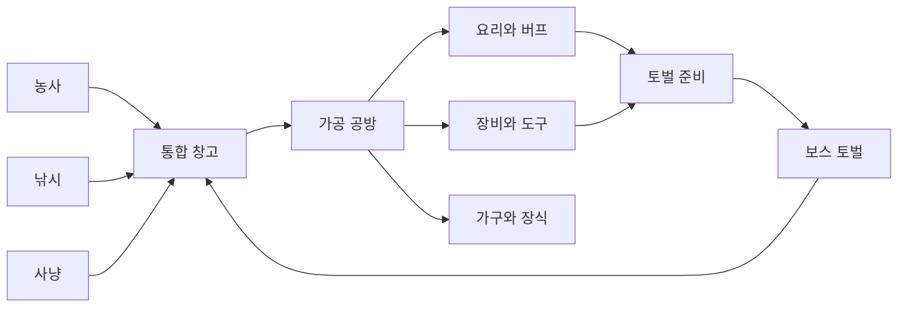

# 사냥·토벌·통합 가공 시스템 기획

> 이 파일은 아이디어와 회의 기록을 보존하는 문서다. 실제 구현의 확정 기준은 `HUNTING_RAID.md`를 따른다.

> 최신 확정안(2026-10-15, 18절 추가): 조작은 **WASD 이동 + 마우스 클릭 공격(직접 조종)**, 체력바·사망 조건, 장비 머리·몸통·다리, 생활펫·전투펫과 가챠 분리, 1~10층 드롭표는 18절을 따른다. 
> 토벌은 **한 층당 5분인 30층 탑 형태의 생존 액션**으로 만든다. 점수 대신 일반 탑·주간 탑의 최고 도달 층을 유저끼리 공유한다. 무기는 최대 +15까지 강화하며, +15와 충분한 컨트롤을 30층 클리어의 기준으로 삼는다. 이 문서의 초기 선택형 전투·점수제·+30 강화 제안과 충돌하는 내용은 아래 17절의 확정안을 우선한다.

## 1. 설계 목표

농사·낚시·사냥을 서로 독립된 돈벌이 수단으로 두지 않고, 통합 창고와 가공 공방을 중심으로 순환시키는 것이 목표다.

- **농사:** 채소·곡물·과일·약초 생산
- **낚시:** 생선·조개·수초·특수 수산물 획득
- **사냥:** 고기·가죽·뼈·깃털·희귀 소재 획득
- **토벌:** 세 생활 콘텐츠로 준비한 장비와 소모품으로 도전하고, 점수를 기록해 다른 유저와 공유하는 콘텐츠
- **가공:** 여러 활동의 재료를 요리·장비·도구·가구로 변환
- **통합 창고:** 현재와 미래의 모든 획득물이 들어가는 공용 인벤토리



## 2. 사냥과 토벌의 역할 구분

### 사냥

일상적인 재료 수집 콘텐츠다. 비교적 짧고 반복하기 쉬우며, 통합 창고에 넣을 원재료를 얻는다.

1. 사냥터와 목표 동물 선택
2. 미끼와 장비 선택
3. 흔적 추적 미니게임
4. 짧은 조우·포획 미니게임
5. 전리품을 통합 창고로 이동

### 토벌

농사·낚시·사냥으로 준비한 결과물을 소비하는 중간·최종 목표다. 복잡한 액션보다 준비와 패턴 공략을 중심으로 한다.

1. 보스 정보와 약점 확인
2. 무기·방어구·음식·도구·동행 펫 편성
3. 공격 예고를 관찰해 공격·방어·회피·아이템·펫 기술 선택
4. 3~5초짜리 행동 미니게임 수행
5. 부위 파괴와 보스 공략
6. 토벌 점수와 평가 내역 확인, 개인 기록 저장 및 유저 간 공유
7. 보스 소재·트로피·해금 보상 획득(보상 구성은 제안)

## 3. 사냥터 구성

| 사냥터 | 주요 동물 | 핵심 보상 | 난이도와 특징 |
|---|---|---|---|
| 들판 | 토끼·꿩·멧돼지 | 고기·털·깃털 | 입문 지역, 농작물 미끼 활용 |
| 숲 | 사슴·여우·곰 | 가죽·뿔·고기 | 추적 중심 |
| 습지 | 오리·수달·뉴트리아 | 깃털·기름·방수 가죽 | 낚시 재료와 연계 |
| 설산 | 산양·늑대 | 두꺼운 가죽·희귀 뿔 | 겨울 장비 필요 |
| 고대 숲 | 정령수·환상 동물 | 마력 소재 | 토벌 이후 해금되는 고급 지역 |

게임 분위기를 유지하기 위해 과도하게 잔혹한 표현보다 추적·마취 화살·포획·정령 정화 같은 표현을 우선한다.

## 4. 사냥 준비와 생활 콘텐츠 연결

### 농사 재료를 사냥에 사용

- 옥수수·고구마 → 멧돼지 미끼
- 당근·양배추 → 토끼 미끼
- 약초 → 회복약·해독제
- 목화·삼 → 붕대·덫 끈
- 버섯 → 냄새 유인제

### 낚시 재료를 사냥에 사용

- 작은 물고기 → 곰·여우·새 미끼
- 물고기 기름 → 방수 장비·등불
- 조개껍데기 → 소리 미끼·장식 재료

### 사냥 재료를 농사와 낚시에 사용

- 뼛가루 → 고급 비료
- 깃털 → 낚시 찌·루어
- 가죽 → 도구 가방·창고 확장품
- 뿔 → 농기구 손잡이
- 벌레 주머니 → 낚시 미끼

## 5. 사냥 전리품 품질

농산물과 동일하게 `보통 → 좋음 ★ → 최상 ★★ → 전설 ✨` 체계를 사용한다.

품질에 영향을 주는 요소:

- 추적 정확도
- 조우 미니게임 성공률
- 장비 등급
- 계절과 날씨
- 목표와 미끼의 궁합
- 포획 과정에서 받은 손상

전설 동물은 반복적으로 처치하는 대상보다 발견·관찰 기록과 특별 소재를 남기는 희귀 이벤트로 표현한다.

## 6. 통합 가공 시스템

### 주방

농산물·생선·고기를 조합해 판매용 음식과 토벌 버프 음식을 만든다.

| 가공품 | 주요 재료 | 효과 또는 용도 |
|---|---|---|
| 감자 고기조림 | 감자 + 멧돼지고기 | 지속 회복 |
| 연어 덮밥 | 곡물 + 연어 + 채소 | 회피 가능 횟수 증가 |
| 매운 전골 | 배추 + 고기 + 고추 | 공격력 증가 |
| 산천어 맑은탕 | 민물고기 + 버섯 + 약초 | 상태 이상 저항 |
| 생선 파이 | 밀 + 달걀 + 생선 | 추적 제한시간 증가 |
| 산해진미 도시락 | 곡물 + 채소 + 생선 + 고기 | 하루 한 번 강력한 복합 버프 |

### 훈연소·건조대

접속하지 않아도 시간이 흐르는 장기 가공 시설이다.

- 생선 → 훈제 생선
- 고기 → 육포
- 과일 → 말린 과일
- 약초 → 말린 약초
- 생가죽 → 무두질한 가죽

원재료보다 가치가 높지만 작업 슬롯을 오래 차지한다.

### 공구 작업대

- 나무 + 가죽 → 씨앗 가방
- 뼈 + 철 → 고급 낚싯바늘
- 가죽 + 깃털 → 화살통
- 뿔 + 목재 → 고급 괭이
- 방수 가죽 + 실 → 낚시 가방

### 인테리어 공방

- 가죽 러그
- 사슴뿔 벽 장식
- 동물 관찰 사진 액자
- 조개 장식
- 물고기 수족관
- 볏짚 쿠션
- 계절별 토벌 트로피 진열장

## 7. 다양한 활동을 유도하는 규칙

시장 가격만으로 다양성을 강제하지 않고 레시피와 목표를 활용한다.

- 서로 다른 분야의 재료가 많을수록 완성품 품질 보너스
- 오늘의 추천 레시피를 매일 변경
- 계절 한정 재료 사용 시 특별 등급 등장
- 미션에서 원재료와 가공품을 함께 요구
- 정확한 품목 대신 `채소 2종 + 고기 1종` 같은 재료 범주 레시피 제공
- 부족한 재료는 시장 구매 또는 대체 재료로 보완 가능
- 오래 숙성할수록 가치가 오르지만 작업 슬롯을 오래 점유

세 활동을 모두 하면 유리하되, 반드시 모두 해야만 진행할 수 있는 구조는 피한다.

## 8. 토벌 준비 화면

토벌 전에 다음 항목을 편성한다.

- 무기 1개
- 방어구 1개
- 음식 2개
- 함정 또는 도구 1개
- 동행 펫 1마리

준비 예시:

- 매운 생선전골 → 공격력 증가
- 약초 고기찜 → 지속 회복
- 훈제 연어 → 회피 횟수 증가
- 튼튼한 가죽옷 → 받는 피해 감소
- 그물 함정 → 빠른 적의 이동 봉쇄
- 고양이 펫 → 약점 발견 확률 증가

생활 콘텐츠로 잘 준비하면 전투가 쉬워지고, 조작 실력이 있으면 부족한 준비를 일부 보완할 수 있어야 한다.

## 9. 토벌 전투

### 공격 예고와 행동 선택

보스 행동을 시각적으로 예고한다.

- 눈이 빛남 → 돌진
- 땅을 긁음 → 광역 공격
- 몸을 웅크림 → 방어
- 울음소리 → 부하 소환

유저는 제한시간 안에 `공격 / 회피 / 방어 / 아이템 / 펫 기술`을 선택한다.

### 행동 미니게임

- 공격 → 움직이는 약점 타이밍 맞추기
- 회피 → 위험 구역 피하기
- 방어 → 게이지 중앙에서 멈추기
- 포획 → 흔들리는 조준점 맞추기
- 치료 → 표시되는 약초를 순서대로 선택

한 번의 토벌은 약 2~4분을 목표로 한다.

### 부위 파괴

- 뿔 파괴 → 돌진 약화, 뿔 소재 획득
- 꼬리 파괴 → 휩쓸기 범위 감소
- 갑옷 파괴 → 방어력 감소
- 날개 파괴 → 비행 패턴 봉쇄

필요한 소재에 따라 공격할 부위를 선택하게 만들어 단순한 체력 감소 반복을 피한다.

## 10. 토벌 실패 규칙

- 장비는 사라지지 않는다.
- 사용한 음식과 소모품만 소진된다.
- 실패해도 관찰 기록과 소량의 흔적 재료를 받는다.
- 같은 보스에게 실패하면 최대 3회까지 `공략 지식`이 쌓인다.
- 공략 지식은 공격 예고시간 증가 또는 받는 피해 감소를 제공한다.

실패도 다음 성공을 위한 진행으로 남아야 한다.

## 11. 토벌 보스 후보

| 보스 | 계절 | 주요 패턴 | 생활 콘텐츠 대응 |
|---|---|---|---|
| 꽃가루 멧돼지 | 봄 | 돌진·꽃가루 시야 방해 | 약초 해독제·그물 |
| 폭풍 메기왕 | 여름 | 물웅덩이·번개 | 낚시 미끼·절연 가죽 |
| 단풍 뿔사슴 | 가을 | 분신·고속 이동 | 향기 미끼·추적 펫 |
| 설산 철갑곰 | 겨울 | 빙결·강한 방어 | 따뜻한 요리·갑옷 파괴 |
| 창고 탐식왕 | 특별 | 보관 재료를 먹고 변화 | 다양한 재료와 창고 관리 |
| 시장 포화 정령 | 특별 | 최근 많이 판 작물에 내성 | 여러 작물·가공품 활용 |

`시장 포화 정령`은 최근 많이 판매한 작물 속성을 흡수해 해당 재료 기반 공격에 강해진다. 현재 시장 포화 시스템을 토벌 전략과 연결하고 여러 작물을 준비하도록 유도할 수 있다.

## 12. 보상 설계

돈만 지급하면 토벌이 또 하나의 최고 수익 콘텐츠가 되므로, 새로운 선택지를 여는 보상을 중심으로 한다.

- 최초 토벌: 신규 지역·작업대·레시피·기능 해금
- 반복 토벌: 장비 제작 소재·강화 재료
- 수집 보상: 보스 가구·트로피·프로필 테두리
- 생활 보상: 특별 씨앗·낚시 미끼·창고 확장 재료
- 펫 보상: 펫 장비·외형
- 도전 보상: 칭호·색상 변형

## 13. 반복 도전 조건

매번 같은 방식으로 체력만 깎는 플레이를 피하기 위해 선택형 주간 조건을 제공한다.

- 회복 음식 최대 1개
- 지정 무기 사용
- 특정 부위 파괴 후 마무리
- 펫 없이 성공
- 제한시간 안에 성공
- 세 종류 이상의 가공품 사용
- 받은 피해 일정량 이하

조건은 추가 보상을 주되 기본 토벌 보상을 막지 않는다.

## 14. 권장 MVP

### 사냥 MVP

- 사냥터: 들판·숲 2곳
- 동물: 6종
- 장비: 나무 활·사냥 활·정밀 활 3종
- 미끼: 농산물·생선 기반 4종
- 추적 미니게임 1종
- 전리품 10종
- 복합 가공 레시피 8종
- 사냥 전용 `바로 판매 / 창고 보관` 설정
- 사냥 미션을 기존 공용 미션에 통합

### 토벌 MVP: 꽃가루 멧돼지

1. 준비 화면
2. 음식·장비·펫 편성
3. 공격·방어·회피 선택
4. 돌진과 꽃가루 패턴
5. 엄니 부위 파괴
6. 성공·실패와 공략 지식
7. 토벌 점수 산출·개인 최고 점수 저장·다른 유저에게 결과 공유
8. 최초 보상으로 엄니 장식과 고급 비료 레시피 해금(제안)

꽃가루 멧돼지로 기본 재미를 검증한 뒤 폭풍 메기왕을 추가해 농사·낚시·사냥 연결까지 시험한다.

## 15. 핵심 원칙

토벌은 전투 실력만으로 이기는 게임이 아니다. 생활 콘텐츠로 충분히 준비하면 안정적으로 이길 수 있고, 조작 실력이 있으면 부족한 준비를 보완할 수 있는 구조를 지향한다.


## 16. 토벌 점수제와 유저 간 공유 (2026-10-14)

### 확정 요구사항

- 토벌의 핵심 진행·평가는 **점수제**로 만든다.
- 획득한 점수를 **유저들끼리 공유**할 수 있어야 한다.
- 이번 작업은 MD 기획 기록만 진행한다. 전투·점수 계산·공유 API·랭킹 UI는 구현하지 않는다.

### 점수 산정 제안 — 미확정

- 결과 화면에 총점과 항목별 점수를 함께 표시한다.
- 기본 항목 후보: 토벌 성공, 제한시간 대비 공략 속도, 회피·방어 정확도, 부위 파괴, 받은 피해, 추가 도전 조건 달성.
- 성공만 점수를 주기보다 실패에도 공략 진행도에 따른 점수를 남겨 개인 기록을 비교하도록 한다.
- 처치 시간 단축으로 장비가 이미 점수에 영향을 주므로 장비 가격·등급 자체에는 추가 점수를 주지 않는 안을 권장한다.
- 같은 행동을 반복해 점수를 무한히 쌓지 못하도록 항목별 상한을 둔다. 부위 파괴는 부위당 한 번, 시간 보너스는 성공 시에만 주는 안을 검토한다.
- 총점 상한, 항목별 배점, 난이도 배율, 실패 시 최대 점수, 동점 처리 규칙은 아직 정하지 않았다.
- 토벌 점수를 소비하는 교환 재화로 쓸지는 미정이다. 우선 도전 기록용 점수로 두는 안을 권장한다.

### 유저 간 공유 제안 — 미확정

- 최소 구현은 결과 화면의 ‘점수 공유’ 버튼이다. 닉네임, 보스, 난이도, 총점, 성공 여부, 공략 시간, 달성일을 담은 결과 카드나 공유 링크를 제공한다.
- 클립보드 복사나 이미지 저장을 대안으로 제공하면 공유 기능을 지원하지 않는 기기에서도 이용할 수 있다.
- 공개 공유는 사용자가 직접 선택한다. 계정 식별자·로그인 토큰·전체 저장 데이터는 공유 내용에 넣지 않는다.
- 랭킹은 점수 공유와 별도 확장안이다. 보스·난이도·점수 규칙 버전별로 분리하고 주간 최고점 및 개인 최고점을 비교하는 구성을 제안한다.
- 공략 지식, 장비·펫·버프 차이가 점수에 영향을 주므로 결과 카드에 도전 조건을 함께 표시한다. 동일 조건 경쟁 모드를 둘지는 추후 결정한다.
- 공개 랭킹을 도입한다면 로컬 저장의 점수를 그대로 신뢰하지 않고 서버에서 도전 ID와 결과를 검증한다. 중복 제출 방지와 점수 규칙 버전 관리가 필요하다.

### 구현 전 결정할 항목

1. 점수 계산식·상한·성공/실패 배점.
2. 공유 형태: 결과 이미지, 링크, 게임 내 게시판 중 최소 범위.
3. 랭킹 포함 여부와 갱신 주기, 로그인 필요 여부.
4. 장비·펫 자유 편성과 동일 조건 경쟁을 어떻게 구분할지.
5. 기존 소재·해금 보상과 점수 기록을 어떻게 연결할지.

## 17. 30층 탑 토벌·무기 강화 최종 기준안 (2026-10-15)

이 절은 토벌 방식과 강화 정책에 관한 최신 합의다. 앞 절의 점수제, 공격·방어 선택형 전투, 빠른 토벌, 보조무기, +30 강화안은 폐기하거나 참고 아이디어로만 남긴다.

### 17.1 핵심 콘셉트

토벌 장소는 총 30층으로 구성된 탑이다. 유저는 생활 콘텐츠에서 얻은 재료로 무기를 만들고 강화하며, 현재 장비로 어디까지 올라갈 수 있는지 도전한다.

```text
농사·낚시·사냥
→ 생활 재료와 골드 획득
→ 생활 무기를 +10까지 강화
→ +10에서 무기 진화 방향 선택
→ 탑에 진입해 상위 재료 획득
→ 무기를 최대 +15까지 강화
→ 더 높은 층 도전
→ 일반 탑·주간 탑의 최고층 공유
```

- 한 층의 전투시간은 5분이다.
- 한 번에 한 층에 도전하며 클리어하면 다음 층을 영구 해금한다.
- 실패해도 해금 층이 내려가지 않는다.
- 점수 대신 일반 탑과 주간 탑의 최고 도달 층을 기록한다.
- 빠른 토벌은 두지 않는다.
- ~~토벌 중 공격은 기본적으로 자동~~ → **유저가 직접 조종한다: WASD 이동, 마우스 클릭 공격**(18.1절).
- 월루 플레이를 위해 일시정지, 창 이탈 시 자동 일시정지 선택, 보스키를 지원한다.

### 17.2 일반 탑과 주간 도전

| 항목 | 일반 탑 | 주간 도전 |
| --- | --- | --- |
| 진행 | 영구 저장 | 매주 초기화 |
| 목표 | 장기 최고층 갱신 | 해당 주 최고층 갱신 |
| 규칙 | 층별 고정 | 매주 환경·적 조합 변경 |
| 장비 | 보유 장비 사용 | 보유 장비 사용 |
| 보상 | 제작·강화 재료 | 강화 재료·외형·칭호 |
| 공유 | 역대 최고층 | 이번 주 최고층 |

주간 도전에는 회복량 감소, 원거리 몬스터 증가, 특정 무기 유불리, 적 이동속도 증가 같은 주간 규칙을 적용한다. 장비는 정규화하지 않으며 결과 공유 시 강화 단계와 진화 방향을 함께 표시한다.

### 17.3 장비 편성

장비는 토벌 입장 화면에서 새로 편성하지 않고 기존 장비창에서 미리 착용한다.

- 주무기 1개
- 머리 방어구 1개
- 몸통 방어구 1개
- 다리 방어구 1개
- 전투펫 1마리
- 음식 최대 3개

보조무기 개념은 사용하지 않는다. 주무기 하나를 영구 강화와 판 안의 각성으로 깊게 성장시키는 구조로 만든다.

방어구 역할은 다음처럼 구분한다.

- 머리: 치명타, 탐지, 경험치 획득 범위, 상태 이상 저항
- 몸통: 최대 체력, 방어력, 보호막, 피해 감소
- 다리: 이동속도, 회피, 밀려남 저항, 바닥 위험 대응

### 17.4 생활펫과 전투펫

현재 농사·낚시 등에 특화된 펫은 `생활펫`으로 유지한다. 토벌에는 별도의 `전투펫` 분류와 장비 슬롯을 만든다.

| 분류 | 적용 콘텐츠 | 역할 예시 |
| --- | --- | --- |
| 생활펫 | 농사·낚시·창고·가공 | 성장속도, 시세, 물, 희귀도 보조 |
| 전투펫 | 일반 탑·주간 도전 | 자동 공격, 보호막, 회복, 약화, 회피 보조 |

전투펫은 공격형, 방어형, 회복형, 지원형으로 나눈다. 생활펫의 능력은 전투에 적용하지 않고 전투펫의 능력도 생활 콘텐츠에 적용하지 않는다.

### 17.5 음식 세 칸

토벌에는 음식을 최대 3개 가져갈 수 있다.

- 회복 음식: 즉시 회복, 지속 회복, 상태 이상 제거, 보호막
- 전투 음식: 일정 시간 공격력·공격속도·이동속도·치명타·보스 피해 증가
- 사용한 음식만 소모하고 사용하지 않은 음식은 반환한다.
- 같은 음식의 중복 장착은 허용하지 않는 안을 우선 검토한다.
- 회복 음식만 세 개 넣는 고정 답을 막기 위해 회복 음식은 최대 두 개로 제한하는 안을 검토한다.

### 17.6 한 층의 전투와 판당 각성

한 층은 5분 동안 진행한다.

1. 장비창에 착용한 장비와 선택한 음식으로 입장한다.
2. 4분 30초 동안 일반·정예 몬스터 웨이브를 상대한다.
3. 보스가 전투 중간에 돌진·지형 생성·부하 소환 등으로 개입한다.
4. 마지막 30초에 보스가 직접 등장한다.
5. 제한시간 안에 보스를 처치하면 다음 층을 해금한다.

버티기만 하는 방어 빌드가 정답이 되지 않도록 마지막 보스를 제한시간 안에 처치해야 한다. 처리하지 못한 일반 몬스터가 보스전에도 남게 하여 화력과 생존력을 모두 요구한다.

영구 강화와 혼동하지 않도록 판 안의 레벨은 `전투 각성 Lv.1~Lv.5`로 표기한다.

| 시간 목표 | 전투 각성 |
| ---: | ---: |
| 입장 | Lv.1 |
| 약 45초 | Lv.2 |
| 약 100초 | Lv.3 |
| 약 170초 | Lv.4 |
| 약 240초 | Lv.5 |
| 300초 | 층 보스 판정 |

Lv.2~Lv.5에서 총 네 번, 세 가지 강화 중 하나를 선택한다. 선택 중에는 전투를 일시정지한다. 새로운 보조무기를 추가하지 않고 착용한 주무기, 방어구 효과, 전투펫 능력을 강화한다. Lv.5에서는 현재 무기 진화에 맞는 최종 공격 형태를 선택한다.

### 17.7 탑의 층 구성

5개 층을 하나의 구간으로 묶는다.

| 층 | 역할 |
| ---: | --- |
| 1층 | 구간의 기본 몬스터와 규칙 소개 |
| 2층 | 빠른 몬스터 추가 |
| 3층 | 원거리·상태 이상 몬스터 추가 |
| 4층 | 정예와 복합 웨이브 |
| 5층 | 구간 보스 |

예시 구간은 다음과 같다.

- 1~5층: 꽃가루 들판
- 6~10층: 침수된 수로
- 11~15층: 단풍 미궁
- 16~20층: 얼어붙은 광산
- 21~25층: 고대 숲
- 26~30층: 탑의 심장부

층이 오르면 체력·공격력만 올리지 않고 이동속도, 출현 수, 원거리 공격, 상태 이상, 바닥 위험, 보스 패턴 조합을 단계적으로 추가한다.

### 17.8 생활 무기와 +10 진화

기본 무기는 농사·낚시·사냥과 관련된 생활 도구에서 시작한다. 영구 강화에 따라 외형과 성능이 점진적으로 바뀌며 +10에서 공격 방식의 방향을 선택한다.

| 기본 생활 무기 | 진화 A | 진화 B |
| --- | --- | --- |
| 농사용 낫 | 전투 대낫 | 회전 수확날 |
| 괭이 | 지진 망치 | 암석 분쇄기 |
| 물뿌리개 | 고압 물대포 | 빙결 분사기 |
| 비료 살포기 | 독성 분사기 | 폭발 씨앗 발사기 |
| 낚시 작살 | 삼지창 | 사슬 작살 |
| 낚싯대 | 번개 낚싯대 | 포획 그물 발사기 |
| 사냥 활 | 연사궁 | 저격 장궁 |
| 엽총 | 소총 | 대형석궁 |
| 사냥 칼 | 쌍검 | 대검 |

진화 방향은 단일 대상·보스 특화와 다수 몬스터·생존 특화처럼 서로 다른 사용감을 제공한다. 진화에 따라 기본 공격, 외형, 판 안의 각성 선택지와 Lv.5 최종 형태가 함께 달라진다.

외형은 +0, +5, +10, +13, +15 같은 주요 구간에서 크게 변화시킨다. 중간 단계에는 금속 부품, 장식, 색상, 빛과 공격 효과를 점진적으로 추가한다.

### 17.9 최대 +15 강화 정책

첫 30층 시즌의 무기 최대 강화는 +15다. 기존 +30안에서 예상했던 총 골드·재료 소비 비용을 +15 구간에 압축한다.

- +1~+10: 농사·낚시·사냥에서 얻은 생활 재료와 골드 사용
- +10: 무기 진화 방향 선택
- +11~+15: 생활 재료, 골드, 탑 재료 사용
- 무기는 파괴되지 않는다.
- 강화는 확률적으로 성공한다.
- 실패하면 투입한 골드와 재료를 소모한다.
- 강화 실패 후 구간별 1~5% 확률로 현재 단계에서 한 단계 하락한다.
- +10에 한 번 도달하면 +9 이하로 내려가지 않으며 선택한 진화도 유지한다.

성공 확률과 하락 확률의 첫 기준안은 다음과 같다.

| 목표 강화 | 성공 확률 | 실패 시 하락 확률 | 재료 구간 |
| ---: | ---: | ---: | --- |
| +1~+3 | 100% | 0% | 기본 생활 재료 |
| +4~+5 | 95% | 1% | 생활 재료 |
| +6~+7 | 85% | 1% | 고급 생활 재료 |
| +8~+9 | 75% | 2% | 고급 생활 재료 |
| +10 | 65% | 2% | 희귀 생활 재료 |
| +11 | 50% | 3% | 1~5층 재료 |
| +12 | 40% | 3% | 6~10층 재료 |
| +13 | 30% | 4% | 11~15층 재료 |
| +14 | 22% | 4% | 16~20층 재료 |
| +15 | 15% | 5% | 21~25층 재료 |

`실패 시 하락 확률`은 전체 시도 확률이 아니라 강화에 실패한 경우에만 판정한다. 예를 들어 +15 시도의 실제 단계 하락 확률은 `실패 85% × 하락 5% = 4.25%`다. 하락은 한 번에 한 단계만 발생한다.

### 17.10 기존 +30안과 같은 기대 비용

새 +15 강화의 표시 비용을 단순히 두 배로 정하지 않는다. 성공 확률, 실패 횟수, 하락 후 복구 비용까지 포함한 기대 총비용을 기존 +30안과 같게 맞춘다.

```text
기대 총비용 =
성공까지의 평균 시도 비용
+ 강화 하락 발생 비용
+ 하락한 단계의 복구 비용
```

기존 +30안의 총 기대 비용을 100으로 볼 때 다음 배분을 첫 기준으로 사용한다.

| 강화 구간 | 기대 비용 비중 |
| ---: | ---: |
| +1~+5 | 5% |
| +6~+9 | 10% |
| +10 | 10% |
| +11 | 12% |
| +12 | 13% |
| +13 | 15% |
| +14 | 17% |
| +15 | 18% |
| 합계 | 100% |

재료는 한 번의 실패를 복구하기 어렵지 않을 정도로 적게 요구하고, 골드를 주된 반복 소비처로 삼는다. 실제 가격은 농사 경제 조정 이후 강화 확률과 하락을 포함한 반복 시뮬레이션으로 확정한다.

### 17.11 강화 하락 방지 아이템

탑에서 매우 낮은 확률로 `안정화석`을 얻을 수 있다.

- 강화 전에 사용 여부를 선택한다.
- 강화 성공 시 소모하지 않는다.
- 일반 실패 시에도 소모하지 않는다.
- 실제 강화 하락 판정이 발생했을 때만 1개를 소모하고 현재 단계를 유지한다.
- 안정화석의 드롭 확률은 어떤 보상원에서도 최대 10%를 넘지 않는다.
- 최초 클리어 확정 지급처럼 사실상 100%인 획득 방식은 두지 않는다.

첫 드롭률 기준안은 다음과 같다.

| 보상원 | 드롭 확률 제안 |
| --- | ---: |
| 일반 층 클리어 상자 | 1% |
| 정예 층 클리어 상자 | 2~3% |
| 5층 단위 보스 | 5% |
| 25층·30층 보스 | 7~8% |
| 주간 도전 상위 보상 상자 | 최대 10% |

드롭률은 낮게 유지하되 실제 하락이 발생할 때만 소모되므로 중요한 +14·+15 도전에서 선택적으로 사용할 수 있다.

### 17.12 탑 구간과 권장 강화 단계

강화 단계는 입장 제한이 아니다. 낮은 강화로도 실력, 방어구, 음식, 전투펫과 무기 상성에 따라 높은 층에 도전할 수 있다.

| 탑 구간 | 권장 무기 강화 | 난이도 목표 |
| ---: | ---: | --- |
| 1~5층 | +10 | 진화 무기 적응 |
| 6~10층 | +10~+11 | 기본 조작과 각성 학습 |
| 11~15층 | +11~+12 | 방어구와 음식 활용 |
| 16~20층 | +12~+13 | 빌드 선택과 전투펫 중요 |
| 21~25층 | +13~+14 | 상위 재료 확보 |
| 26~29층 | +14~+15 | 최종 구간 |
| 30층 | +15 | 컨트롤하면 클리어 가능 |

30층 난이도 기준은 다음과 같다.

- +13: 최적 장비·음식·전투펫과 매우 뛰어난 컨트롤이 필요한 극한 도전
- +14: 숙련 유저는 클리어 가능하나 평균 유저는 보스 화력이나 생존이 부족
- +15: 평균 유저가 빌드를 잘 구성하고 컨트롤하면 클리어 가능

+15는 자동 클리어를 보장하지 않으며 30층의 권장 전투력이다. 모든 +15 무기는 적절한 방어구·전투펫·음식과 컨트롤로 30층을 클리어할 수 있어야 한다. 무기 타입에 따라 일반 웨이브, 정예, 보스에서 느끼는 난이도는 달라질 수 있다.

### 17.13 30층 이후의 성장

+15 이후 숫자 강화를 바로 추가하지 않는다. 30층 이후 보상은 수평 성장과 다른 장비 육성에 사용한다.

- 무기 진화 특성 추가 해금
- 반대 진화 무기 제작
- 머리·몸통·다리 방어구 제작 및 강화
- 전투펫 획득과 성장
- 음식 레시피 해금
- 안정화석 획득 기회
- 무기·방어구·펫 외형
- 주간 도전 칭호와 프로필 장식
- 다른 생활 무기를 +15까지 육성

### 17.14 최고층 공유

공유의 핵심은 점수가 아니라 일반 탑과 주간 도전의 최고층이다. 결과 카드에는 빌드와 도전 조건을 함께 표시한다.

```text
월루탑 30층 돌파

무기: 대형석궁 +15
진화: 공성 특화
머리: 매의 두건
몸통: 철갑 가죽옷
다리: 바람 장화
전투펫: 여우불

최종 각성: 공성 석궁
사용 음식: 매운 전골 / 산천어탕 / 육포
```

아직 클리어하지 못한 경우에도 `30층 도전 중 · 보스 체력 12% 남음`처럼 현재 진행 상황을 공유할 수 있다. 계정 식별자, 로그인 토큰, 전체 저장 데이터는 공유 내용에 포함하지 않는다.

## 18. 2차 확정 사항 (2026-10-15)

17절을 보완한다. 17절과 다르면 이 절을 우선한다. 첫 구현 목표는 **1~10층**이다.

### 18.1 조작: 직접 조종

자동 공격이 아니다. 유저가 캐릭터를 직접 움직이고 공격한다.

| 입력 | 동작 |
| --- | --- |
| W·A·S·D | 8방향 이동 |
| 마우스 이동 | 조준(캐릭터가 커서 방향을 본다) |
| 마우스 왼쪽 클릭(누르고 있으면 연속) | 무기 공격. 무기마다 사거리·범위·공격 간격이 다르다 |
| 1·2·3 | 장착한 음식 1~3번 사용 |
| Space | **긴급 회피**(확정): 이동 방향으로 짧게 대시, 대시 중 무적, 쿨타임 있음(다리 방어구로 줄어든다) |
| P | 일시정지 |
| Esc | 보스키(즉시 일시정지 + 위장 화면) |

- **창을 벗어나면 자동 일시정지를 기본으로 켠다**(월루 플레이 보호). 설정에서 끌 수 있다.
- 각성 선택 중에는 전투를 멈춘다.
- 구현 메모: 전투 화면은 React 상태로 매 프레임 그리지 않고 `<canvas>` + 별도 게임 루프(requestAnimationFrame)로 만든다. 결과(클리어·실패·획득물)만 게임 상태로 넘긴다. 위젯의 작은 창에서도 보이도록 전투 영역은 고정 비율로 확대·축소한다.

### 18.1.1 사냥 무기와 토벌 무기는 별개 (확정)

- **사냥터 무기**(맨손·딱총·활·석궁·엽총)는 사냥터에서만 쓰고, 토벌 무기와 공유·변환하지 않는다.
- **토벌 무기**(17.8절의 낫·괭이·물뿌리개·비료 살포기·작살·낚싯대·사냥 활·엽총·사냥 칼)는 따로 만들고 강화한다.
- 토벌 무기는 생활과 이어지는 느낌을 주려고 **생활 도구에서 착안**한 것이다. 이름·외형·공격 방식에서 그 느낌을 살린다(예: 낫은 앞쪽 부채꼴 베기, 물뿌리개는 물줄기 범위 공격, 작살은 직선 관통 찌르기). 토벌의 "사냥 활"·"엽총"은 사냥터의 같은 이름 무기와 다른 별개 아이템이다.

### 18.2 체력과 사망 조건

- 화면에 **플레이어 체력바**를 둔다. 기본 최대 체력 100, 몸통 방어구 등으로 늘어난다.
- 몬스터에게 닿거나 원거리 공격·바닥 위험에 맞으면 체력을 잃는다. 방어력만큼 피해가 줄어든다(최소 1).
- 맞은 직후 0.6초 무적(깜빡임)으로 연속 피해를 막는다.
- **체력이 0이 되면 그 층 도전 실패.** 5분 안에 층 보스를 처치하지 못해도 실패다.
- 실패 규칙(17·10절 유지): 해금 층은 내려가지 않고, 장비는 잃지 않으며, **사용한 음식만 소모**된다. 그 판에서 처치한 몬스터 수에 비례해 그 구간의 일반 재료를 소량 받는다.

### 18.3 주방 요리: 전투 스타일에 맞춘 효과

예전 사냥용 효과(추적 시간·회피 횟수)는 버린다. 탑 전투에서 쓰는 효과로 바꾼다. 요리 미니게임의 등급(보통·맛있음★·일품★★)은 유지하고 수치만 등급별로 오른다.

| 요리 | 종류 | 효과(보통 / 맛있음 / 일품) |
| --- | --- | --- |
| 🍲 매운탕 | 전투 | 60초 동안 공격력 +10% / +15% / +22% |
| 🥘 감자 생선조림 | 회복 | 즉시 체력 25 / 35 / 50 회복 |
| 🥗 텃밭 비빔밥 | 전투 | 60초 동안 이동속도 +12% / +18% / +25% |
| 🐟 생선구이 정식 | 회복 | 보호막 20 / 30 / 45 (피해를 먼저 흡수, 60초) |
| 🍱 산해진미 도시락 | 전투 | 45초 동안 공격력·공격속도·이동속도 +6% / +9% / +13% |
| (추가 예정) 약초 고기찜 | 회복 | 20초 동안 초당 체력 2 / 3 / 4 회복 |
| (추가 예정) 꼬치구이 | 전투 | 60초 동안 공격속도 +12% / +18% / +25% |

- 음식은 최대 3칸, **같은 음식 중복 장착 금지, 회복 음식은 최대 2칸**(17.5절 검토안 확정).
- 한 판에서 각 음식은 한 번 사용한다. 사용한 음식만 소모하고 쓰지 않은 음식은 돌려준다.
- 사냥 소재(고기류)를 쓰는 레시피를 추가해 사냥과 연결한다.

### 18.4 장비: 머리·몸통·다리

- 장비 칸: **무기 1 · 머리 1 · 몸통 1 · 다리 1 · 전투펫 1 · 음식 3**. 토벌 입장 전에 장비창에서 미리 착용한다.
- 지금 `app/equipment.ts`의 `weapon`·`armor` 칸 중 `armor`를 `head`·`body`·`legs` 세 칸으로 나눈다(이펙트 칸 farm·fish·hunt는 그대로).
- 역할(17.3절): 머리 = 치명타·탐지·경험치 흡수 범위·상태 이상 저항, 몸통 = 최대 체력·방어력·보호막, 다리 = 이동속도·회피 대시 쿨타임·밀려남 저항.
- 첫 구현(1~10층)용 방어구는 부위마다 2단계(가죽 → 강화 가죽)만 두고, 사냥 소재와 탑 재료로 제작한다.

### 18.5 펫: 생활펫과 전투펫 분리, 가챠도 분리

| | 생활펫 | 전투펫 |
| --- | --- | --- |
| 대상 | **지금 있는 모든 펫** | 새로 만든다 |
| 효과 | 농사·낚시·창고·가공(지금 능력 그대로) | 탑 전투에서만(자동 공격·보호막·회복·약화) |
| 가챠 | 기존 **펫 뽑기 = 생활펫 뽑기** | **전투펫 뽑기를 따로 만든다**(별도 확률표·가격) |
| 장착 | 집·마당에 두면 효과 | 장비창 전투펫 칸 1마리 |

- 생활펫 능력은 전투에 적용하지 않고, 전투펫 능력은 생활 콘텐츠에 적용하지 않는다.
- 전투펫 분류: 공격형(같이 공격), 방어형(보호막·도발), 회복형(주기적 회복), 지원형(적 둔화·경험치 흡수 범위).
- 전투펫 뽑기 첫 안: 일반 70% · 희귀 25% · 전설 5%, 탑 재료 또는 골드로 뽑는다(가격은 경제 시뮬레이션 후 확정). 상점의 가챠 탭에서 "생활펫 뽑기 / 전투펫 뽑기"로 나눠 보여 준다.

### 18.6 1~10층 드롭표 (첫 구현 범위)

구간: **1~5층 꽃가루 들판**(5층 보스: 꽃가루 멧돼지), **6~10층 침수된 수로**(10층 보스: 폭풍 메기왕).

탑 재료:

| 재료 | 구간 | 등급 | 쓰임 |
| --- | --- | --- | --- |
| 🌼 꽃가루 뭉치 | 1~5층 | 일반 | 방어구 제작, +11 강화 |
| 🌿 들판 정수 | 1~5층 | 고급 | +11 강화, 전투펫 뽑기 |
| 🦷 꽃가루 멧돼지 엄니 | 5층 보스 | 보스 | +11 강화 핵심, 엄니 장식 |
| 💧 수로 이끼 | 6~10층 | 일반 | 방어구 제작, +12 강화 |
| 🔷 물안개 결정 | 6~10층 | 고급 | +12 강화, 전투펫 뽑기 |
| ⚡ 폭풍 메기 수염 | 10층 보스 | 보스 | +12 강화 핵심, 트로피 |
| 🪨 안정화석 | 전 층 | 특수 | 강화 하락 1회 방지(17.11절) |

층별 보상(클리어 상자). 첫 클리어는 한 번만, 반복 클리어는 매번:

| 층 | 역할 | 첫 클리어 | 반복 클리어 | 안정화석 |
| ---: | --- | --- | --- | ---: |
| 1 | 소개 | 골드 300 · 꽃가루 뭉치 3 | 꽃가루 뭉치 1~2 | 1% |
| 2 | 빠른 몬스터 | 골드 400 · 꽃가루 뭉치 3 | 꽃가루 뭉치 1~3 | 1% |
| 3 | 원거리·상태 이상 | 골드 500 · 꽃가루 뭉치 3 · 들판 정수 1 | 꽃가루 뭉치 2~3 · 들판 정수 20% | 1% |
| 4 | 정예 | 골드 700 · 들판 정수 2 | 꽃가루 뭉치 2~4 · 들판 정수 1 | 2% |
| 5 | **보스: 꽃가루 멧돼지** | 골드 1,500 · 들판 정수 3 · 엄니 1 | 들판 정수 1~2 · 엄니 30% | 5% |
| 6 | 소개 | 골드 600 · 수로 이끼 3 | 수로 이끼 1~2 | 1% |
| 7 | 빠른 몬스터 | 골드 700 · 수로 이끼 3 | 수로 이끼 1~3 | 1% |
| 8 | 원거리·상태 이상 | 골드 800 · 수로 이끼 3 · 물안개 결정 1 | 수로 이끼 2~3 · 물안개 결정 20% | 1% |
| 9 | 정예 | 골드 1,000 · 물안개 결정 2 | 수로 이끼 2~4 · 물안개 결정 1 | 3% |
| 10 | **보스: 폭풍 메기왕** | 골드 2,500 · 물안개 결정 3 · 메기 수염 1 | 물안개 결정 1~2 · 메기 수염 30% | 5% |

- 실패 시: 그 판 처치 수 20마리당 그 구간 일반 재료 1개(최대 3개).
- 골드는 일부러 적게 둔다(토벌이 최고 돈벌이가 되지 않게, 12절). 반복 보상의 중심은 강화 재료다.
- 판 안에서 몬스터가 떨어뜨리는 것은 **경험치 구슬**(전투 각성용)뿐이다. 재료는 클리어 상자로만 받는다.
- 수치는 첫 기준안이다. 강화 비용 시뮬레이션과 플레이 테스트 후 조정한다.

### 18.7 첫 구현 순서

1. 장비 칸 분리(머리·몸통·다리), 생활 무기 1종(낫) +1~+10 강화(생활 재료·골드).
2. 주방 요리 효과를 18.3절로 교체(주방은 토벌과 함께 공개).
3. 탑 1~5층: WASD·클릭 전투, 체력바, 웨이브, 각성 선택, 꽃가루 멧돼지, 드롭표.
4. 6~10층, 방어구 제작, 전투펫과 전투펫 뽑기, 결과 카드 공유.

